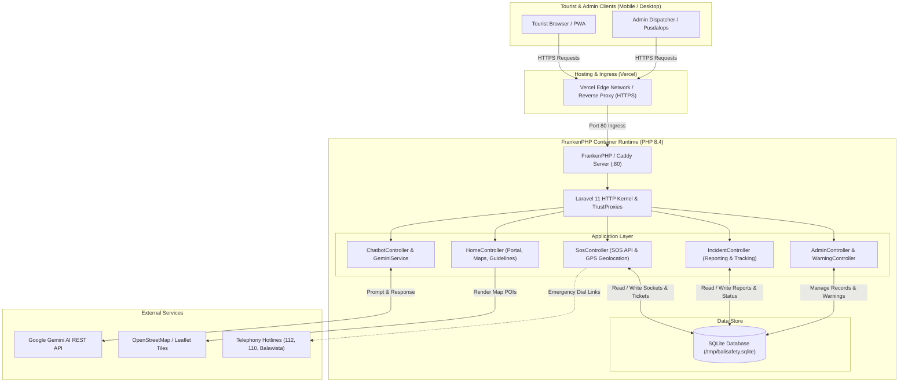

# BaliGuard - Integrated Bali Tourist Safety & Emergency Response System

## Description
**BaliGuard** is a comprehensive, mobile-first web platform engineered to protect, assist, and inform international and domestic tourists visiting Bali, Indonesia. Integrating real-time emergency dispatching, incident reporting, interactive safety geospatial mapping, and an intelligent safety assistant powered by **Google Gemini AI**, BaliGuard bridges the critical communication gap between tourists, the Tourist Police (*Polda Bali*), coastal lifeguards (*Balawista*), traditional village security (*Pecalang*), disaster mitigation agencies (*BPBD Bali*), and healthcare facilities.

Inspired by regional safety governance initiatives and Bali Provincial Regulation (*Perda*) No. 2/2024, BaliGuard provides a unified command-and-response ecosystem that preserves tourist well-being and upholds the cultural sanctity of the Island of the Gods.

---

## Problem & Target User

### The Problems
1. **Scattered Emergency Contact Channels:** When tourists face critical situations (e.g., motorbike accidents, rabies exposure from monkey/dog bites, rip currents, scams, or stolen travel documents), they rarely know the localized emergency numbers or how to convey their coordinates accurately.
2. **Lack of Unified Multi-Agency Dispatch:** First responders—such as Tourist Police, Balawista lifeguards, local hospital ambulances, and customary *Pecalang*—often operate in silos without a centralized operational feed.
3. **Language & Cultural Etiquette Barriers:** Unintentional violations of sacred temple norms (*cuntaka* / dress codes) and vulnerability to unauthorized money changers frequently arise due to fragmented advisory channels.
4. **Opaque Case Resolution:** Tourists filing police or security reports typically have no way to monitor the live investigation progress once they leave the scene.

### Target Users
- **International & Domestic Tourists:** Travelers exploring Bali who require instant emergency assistance, incident reporting with tracking, safety maps, cultural etiquette guidance, and 24/7 AI advisory.
- **Dispatchers & Emergency Responders:** Field officers, Tourist Police officers (*Polisi Pariwisata Polda Bali*), *Balawista* lifeguards, *BPBD Bali* personnel, and *Pecalang* monitoring live SOS alerts and managing incident reports.
- **Tourism Boards & Local Authorities:** Government stakeholders overseeing regional risk mitigation, BMKG early warning broadcasts, and tourist satisfaction.

---

## Key Features

### 1. 🚨 One-Tap 24/7 Panic SOS Button
- **Automatic GPS Satellite Detection:** Acquires precise latitude and longitude directly through the browser Geolocation API.
- **Emergency Categorization:** Instant selection between Medical/Ambulance, Crime/Police, Ocean Rescue/SAR (*Balawista*), Natural Disaster, and Harassment.
- **Instant Emergency Ticket Generation:** Generates unique tracking tickets (e.g., `SOS-20261112-9A12`) routed to the Command Center.
- **Direct Hotline Fallback:** Rapid one-tap dialers for 112 (National Emergency), 110 (Police), 118/119 (Ambulance), 115 (BASARNAS), and Tourist Police (+62 361 224111).

### 2. 📋 Structured Incident Reporting & 4-Stage Live Tracking
- **Online Complaint Filing (`/report`):** Guided form capturing identity documents (KTP/Passport), regency, incident category, timestamp, narrative, and automatic GPS coordinate lock.
- **Unique Tracking Code:** Issues a reference code (e.g., `BG-26-8841A`).
- **Live 4-Stage Progress Timeline (`/track/{code}`):**
  1. *Laporan Masuk (Submitted)* &rarr; 2. *Verifikasi Berkas (Under Investigation)* &rarr; 3. *Tindakan Lapangan (In Action)* &rarr; 4. *Selesai Ditangani (Resolved)*.
- **Official Transparency:** Displays assigned enforcement agencies (e.g., *Polsek Kuta Utara & Balawista*) and ongoing field officer update notes.

### 3. 🤖 Multilingual Safety Chatbot Powered by Google Gemini AI
- **Official Google Gemini Integration:** Powered by `gemini-3.5-flash-lite` with specialized safety system grounding.
- **Deep Bali Safety Knowledge Base:** Pre-grounded with rabies Anti-Rabies Vaccine (VAR) referral centers (RSUP Prof. Ngoerah/Sanglah, BIMC, Siloam), temple customs (Perda No. 2/2024), ocean rip current warnings, certified money changer rules, and vehicle rental laws.
- **Automatic Multilingual Translation:** Answers seamlessly in Indonesian, English, Russian, Mandarin, German, French, and Japanese.
- **Offline / Zero-Key Fallback Simulator:** If an API key is absent or offline, an embedded heuristic intent parser ensures tourists still receive instant, verified safety instructions.

### 4. 🗺️ Interactive Geospatial Safety & Facility Map (`/map`)
- **Leaflet.js & OpenStreetMap:** Lightweight, responsive interactive map covering all 9 regencies of Bali.
- **Categorized POIs:** International hospitals, rabies vaccine centers, 24/7 Tourist Police posts, Balawista lifeguard towers, and high-hazard ocean wave zones (e.g., Kelingking Beach, Double Six Seminyak).
- **User Location Geonavigation:** One-click device geolocation centering with interactive facility markers.

### 5. 🛕 Official Cultural Etiquette & Do's & Don'ts Guide (`/guidelines`)
- Legal references to Bali Provincial Regulation (*Perda*) No. 2/2024.
- Sacred temple attire instructions (sarong/kamen) and biological restrictions (*cuntaka*).
- Safe road travel protocols: mandatory SNI helmet standards, international driving licenses, and respectful conduct.
- Authorized Money Changer verification guidelines certified by Bank Indonesia.

### 6. ⚠️ Early Warning System (EWS Broadcasts)
- Disseminates meteorological warnings from BMKG Wilayah III Denpasar, high ocean tide/rip current advisories, extreme weather notices, and volcanic status alerts across the homepage.

### 7. 🛡️ Command Center & Dispatcher Operations Dashboard (`/admin`)
- **Executive Metrics:** Real-time metrics tracking Active SOS signals, Pending Inquiries, and Resolved Cases.
- **Live SOS Radar:** Direct links opening coordinates in Google Maps with responder assignment controls.
- **Incident Management:** Filter by regency, status, or search term; assign designated units; and publish status progression notes.
- **Warning Publisher:** Instant deployment of regional hazard alerts.
- **Dedicated Admin Authentication (`/admin/login`):** Session-authenticated access with logout functionality and proxy header verification.

---

## Tech Stack

| Layer | Technologies |
|---|---|
| **Backend Framework** | PHP 8.4, Laravel 11 |
| **Web Server & Runtime** | FrankenPHP (Caddy Go Web Server), PHP-FPM / Worker Mode |
| **Database & ORM** | SQLite (with auto-migrating, idempotent seeders; MySQL-ready Eloquent ORM) |
| **Frontend & UI** | Blade Templating Engine, Tailwind CSS, Font Awesome 6 Icons |
| **Mapping & GIS** | Leaflet.js, OpenStreetMap Cartography, HTML5 Geolocation API |
| **Artificial Intelligence** | Google Gemini API (`gemini-3.5-flash-lite`) via Google AI Studio |
| **Containerization** | Docker (Multi-stage build, non-root `www-data` execution) |
| **Cloud Hosting & CI/CD** | Vercel (Fluid Compute OCI Container Runtime), GitHub Actions / Webhooks |

---

## AI Implementation

BaliGuard embeds **Google Gemini** as an omnipresent safety copilot for tourists navigating unfamiliar environments:

```
[User Query in Chat Widget]
            │
            ▼
[ChatbotController & GeminiService]
            │
            ├─► 1. Grounding Prompt Injection
            │      - Perda No. 2/2024 (Sacred sites, dress codes, cuntaka rules)
            │      - Rabies Treatment Protocol (VAR centers: RS Sanglah, BIMC, Siloam)
            │      - Ocean Safety (Rip currents, Balawista red flag compliance)
            │      - Official Hotlines (112, 110, 115, Tourist Police)
            │      - Authorized Money Changer criteria (Bank Indonesia badge)
            │
            ├─► 2. API Dispatch to Google AI Studio (gemini-3.5-flash-lite)
            │
            └─► 3. Intelligent Fallback Heuristic Matcher
                   - Seamlessly fires if GEMINI_API_KEY is not set or network fails
                   - Zero downtime, high accuracy localized answers
```

- **Prompt Engineering & Safety Guardrails:** System prompts restrict the model to safety, health, regulatory, and emergency advisory topics, explicitly instructing tourists in acute distress to call `112` or trigger the red SOS button.
- **Session Continuity:** Maintains recent conversation history to provide contextual, multi-turn follow-ups.

---

## Architecture / Data Flow



---

## Installation / Run Instructions

### Prerequisites
- **PHP:** 8.2 or higher (PHP 8.3 / 8.4 recommended)
- **Composer:** 2.x
- **Extensions required:** `pdo_sqlite`, `curl`, `mbstring`, `intl`, `zip`

### Local Development Setup

1. **Clone the repository:**
   ```bash
   git clone https://github.com/sanjayawayan/balisafety.git
   cd balisafety
   ```

2. **Install PHP dependencies:**
   ```bash
   composer install
   ```

3. **Configure Environment File:**
   ```bash
   cp .env.example .env
   php artisan key:generate
   ```

4. **Prepare Database:**
   ```bash
   touch database/database.sqlite
   php artisan migrate --seed
   ```

5. **Configure Google Gemini AI (Optional):**
   Obtain a free API Key from [Google AI Studio](https://aistudio.google.com/) and paste it in `.env`:
   ```env
   GEMINI_API_KEY=AIzaSy...your_gemini_api_key...
   GEMINI_MODEL=gemini-3.5-flash-lite
   ```
   *(If omitted, BaliGuard will seamlessly operate using its built-in local knowledge base simulator).*

6. **Start the Local Development Server:**
   ```bash
   php artisan serve
   ```
   Open your browser at: **`http://127.0.0.1:8000`**

---

## Deployment URL

- **Production URL:** [https://balisafety.vercel.app](https://balisafety.vercel.app)
- **Incident Reporting:** [https://balisafety.vercel.app/report](https://balisafety.vercel.app/report)
- **Live Incident Tracking Sample:** [https://balisafety.vercel.app/track/BG-26-8841A](https://balisafety.vercel.app/track/BG-26-8841A)
- **Interactive Safety Map:** [https://balisafety.vercel.app/map](https://balisafety.vercel.app/map)
- **Cultural Guidelines (Do's & Don'ts):** [https://balisafety.vercel.app/guidelines](https://balisafety.vercel.app/guidelines)
- **Admin Command Center:** [https://balisafety.vercel.app/admin/login](https://balisafety.vercel.app/admin/login)

---

## Demo Account (jika diperlukan - jangan simpan password sensitif di public repo)

For jury review and sandbox evaluation of the Command Center & Dispatcher Dashboard:

- **Login URL:** [https://balisafety.vercel.app/admin/login](https://balisafety.vercel.app/admin/login)
- **Username:** `admin`
- **Password:** `baliguard2026`
- **Assigned Role:** Petugas Piket Terpadu (Pusdalops BaliGuard Command Center)

> [!NOTE]
> In production environments, credentials can be overridden without code changes by setting the `ADMIN_USERNAME` and `ADMIN_PASSWORD` environment variables in the host settings.

---

## Known Limitations

1. **Ephemeral Container Storage:** The demo deployment runs on Vercel's container runtime with an ephemeral SQLite database located in `/tmp`. Database state resets across container rebuilds or instance recycles. For large-scale production, connection to a persistent managed database (e.g., Supabase PostgreSQL or PlanetScale MySQL) is recommended.
2. **Client-Side Geolocation Permissions:** Automatic GPS locking relies on browser permission grants. When tourists decline location sharing, the system gracefully prompts for landmark descriptions.
3. **Free-Tier AI Rate Limits:** The default Google Gemini free API tier is subject to standard RPM quotas; when limits are exceeded, BaliGuard falls back to the deterministic local knowledge engine to ensure uninterrupted safety guidance.

---

## Third-party Resources / Credits

- **Google Gemini API:** Generative AI inference and multilingual natural language processing.
- **Leaflet.js & OpenStreetMap:** Open-source interactive cartography and geospatial mapping tiles.
- **Tailwind CSS & Font Awesome 6:** UI framework and vector iconography.
- **FrankenPHP:** High-performance PHP application server written in Go by Kévin Dunglas.
- **Dinas Pariwisata Provinsi Bali & Satpol PP Pariwisata:** Regulatory framework inspiration (*Perda No. 2/2024*).
- **Balawista Badung, Polda Bali, & BMKG Denpasar:** Operational emergency protocols and real-world safety parameters.

---

## Team Member
1. **I Putu Nayaka Widhyadana**
2. **I Wayan Karang Sanjaya**
