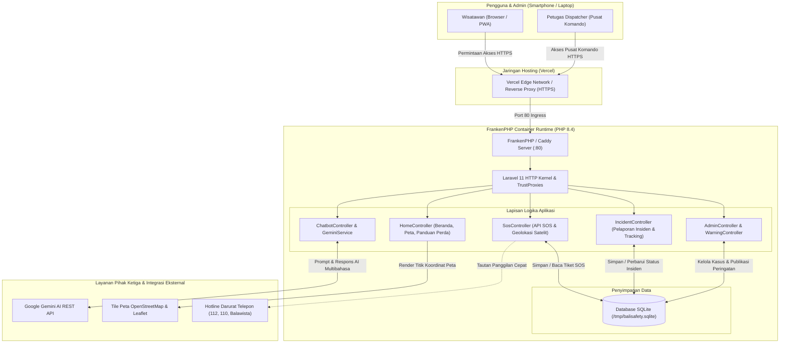

# BaliGuard - Sistem Keselamatan & Perlindungan Wisatawan Terpadu Bali

## Description
**BaliGuard** adalah platform web responsif terpadu (*mobile-first*) yang dirancang khusus untuk memperkuat keamanan, keselamatan, dan kenyamanan wisatawan mancanegara maupun nusantara selama berlibur di Pulau Bali. 

Mengintegrasikan tombol darurat sinyal SOS instan, formulir pelaporan insiden daring dengan pelacakan *real-time*, peta keselamatan interaktif fasilitas vital, serta asisten keselamatan cerdas berbasis **Google Gemini AI**, BaliGuard menjembatani kesenjangan koordinasi dan komunikasi cepat antara wisatawan dengan berbagai instansi garis depan: Polisi Pariwisata (*Polda Bali*), Badan Penyelamat Wisata Tirta (*Balawista*), Badan Penanggulangan Bencana Daerah (*BPBD Bali*), Satuan Keamanan Adat (*Pecalang*), dan jejaring fasilitas kesehatan rujukan internasional di Bali.

Platform ini dikembangkan merujuk pada tata kelola keamanan pariwisata daerah serta Peraturan Daerah (Perda) Provinsi Bali No. 2 Tahun 2024 tentang Tata Kelola Kepariwisataan Bali.

---

## Problem & Target User

### Permasalahan yang Dihadapi (Problem)
1. **Saluran Kontak Darurat yang Terpecah-pecah:** Saat mengalami situasi genting (kecelakaan lalu lintas sewa motor, gigitan hewan penular rabies seperti anjing/kera, arus pecah laut *rip current*, kehilangan dokumen paspor, penipuan valuta asing, atau tindak kriminalitas), wisatawan kerap bingung menentukan nomor darurat yang tepat serta kesulitan memberikan titik lokasi koordinat mereka secara akurat.
2. **Ketiadaan Sistem Dispatcher Terpadu Lintas Instansi:** Unit penanggap pertama di Bali (Polisi Pariwisata, Balawista penjaga pantai, unit ambulans rumah sakit, dan Pecalang satgas desa adat) beroperasi di pos masing-masing tanpa satu sistem koordinasi pelacakan tiket darurat terpusat.
3. **Kendala Bahasa & Ketidaktahuan Tata Krama Budaya:** Pelanggaran norma kesucian kawasan Pura (*cuntaka*, busana kain kamen) serta risiko penipuan di *money changer* tanpa izin Bank Indonesia kerap terjadi akibat kurangnya media edukasi interaktif yang ramah wisatawan.
4. **Minimnya Transparansi Perkembangan Kasus:** Wisatawan yang melapor sering kali tidak mengetahui apakah laporannya telah ditindaklanjuti atau instansi mana yang sedang bergerak ke tempat kejadian perkara (TKP).

### Pengguna Sasaran (Target User)
- **Wisatawan Mancanegara & Domestik:** Pengguna utama yang memerlukan akses tombol darurat cepat (SOS), pelaporan insiden, pelacakan berkas aduan, peta fasilitas kesehatan & keamanan, serta konsultasi keselamatan 24 jam dengan AI multibahasa.
- **Petugas Dispatcher & Tim Reaksi Cepat (Pusdalops):** Petugas piket terpadu, Polisi Pariwisata, petugas Balawista, BPBD, dan Satgas Adat Pecalang yang mengelola panggilan darurat masuk dan memperbarui status penanganan laporan.
- **Dinas Pariwisata & Pemangku Kepentingan Daerah:** Otoritas pemerintah daerah untuk pemantauan tren keamanan pariwisata dan penyebaran peringatan dini BMKG.

---

## Key Features

### 1. 🚨 Tombol Darurat Cepat 24/7 (Panic SOS Button)
- **Deteksi Koordinat Satelit Otomatis:** Mendeteksi posisi lintang (*latitude*) dan bujur (*longitude*) pengguna secara akurat melalui browser Geolocation API tanpa perlu pengetikan manual.
- **Kategori Darurat Lengkap:** Pilihan satu ketukan untuk Darurat Medis/Ambulans, Kriminal/Polisi, Penyelamatan Laut/SAR (Balawista), Bencana Alam, dan Pelecehan.
- **Tiket Sinyal Darurat Unik:** Menerbitkan nomor tiket darurat instan (cth: `SOS-20261112-9A12`) yang langsung masuk ke radar pemantauan Pusat Komando.
- **Panggilan Satu Ketukan (Direct Hotlines):** Akses cepat langsung menelepon 112 (Bebas Pulsa), 110 (Polisi), 118/119 (Ambulans), 115 (BASARNAS), dan Call Center Tourist Police Polda Bali (`+62 361 224111`).

### 2. 📋 Formulir Pengaduan Insiden & Pelacakan Live 4 Tahap
- **Formulir Pengaduan Terstruktur (`/report`):** Pengisian data identitas (KTP/Paspor), kabupaten kejadian, kategori insiden, waktu kronologi, deskripsi terperinci, dan tombol kunci koordinat GPS otomatis.
- **Kode Pelacakan Unik:** Menerbitkan kode pelacakan resmi (cth: `BG-26-8841A`).
- **Timeline Progres Live 4 Tahap (`/track/{code}`):**
  1. *Laporan Masuk (Submitted)* &rarr; 2. *Verifikasi Berkas (Under Investigation)* &rarr; 3. *Tindakan Lapangan (In Action)* &rarr; 4. *Selesai Ditangani (Resolved)*.
- **Transparansi Penanganan:** Menampilkan instansi penanggung jawab yang ditugaskan (cth: *Polsek Kuta Utara & Balawista*) serta catatan resmi perkembangan penyelidikan petugas lapangan.

### 3. 🤖 Chatbot AI Keselamatan Terpadu Google Gemini
- **Ditenagai Google Gemini AI:** Memanfaatkan model resmi `gemini-3.5-flash-lite` melalui antarmuka REST API Google AI Studio.
- **Knowledge Base Khusus Keselamatan Bali:** Dilengkapi pemahaman mendalam mengenai tata tertib kawasan Pura (Perda Bali No. 2/2024), protokol penanganan gigitan anjing/kera dan faskes rujukan Vaksin Anti Rabies / VAR (RSUP Sanglah, BIMC, Siloam), zona bahaya arus pecah (*rip current*), aturan legal sewa sepeda motor & helm SNI, dan ciri *money changer* resmi berizin Bank Indonesia.
- **Multibahasa Otomatis:** Merespons secara luwes dalam Bahasa Indonesia, Inggris, Rusia, Mandarin, Jerman, Prancis, dan bahasa internasional lainnya.
- **Simulator Cerdas Tanpa Kuota / Offline (Fallback):** Jika API key tidak diisi atau terjadi gangguan internet, sistem otomatis beralih ke pencocok maksud heuristik (*intent matcher*) lokal berpengetahuan Bali tanpa menimbulkan error.

### 4. 🗺️ Peta Interaktif Fasilitas Keamanan & Pos Vital (`/map`)
- **Berbasis Leaflet.js & OpenStreetMap:** Ringan, interaktif, dan mulus dibuka pada smartphone wisatawan.
- **Titik Fasilitas Vital 9 Kabupaten:** Menampilkan Rumah Sakit Standar Internasional & Faskes Rujukan Rabies, Pos Polisi 24 Jam & Polisi Pariwisata, Menara Pengawas Lifeguard Balawista, serta Zona Rawan Ombak (Pantai Kelingking Nusa Penida, Double Six Seminyak).
- **Fitur Lokasi Pengguna:** Tombol penunjuk posisi pengguna saat ini secara instan di atas peta.

### 5. 🛕 Panduan Resmi Tata Krama & Do's and Don'ts (`/guidelines`)
- Rangkuman aturan resmi Perda Provinsi Bali No. 2 Tahun 2024.
- Etika busana adat kain kamen/sarong di tempat suci serta larangan masuk saat masa berduka/haid (*cuntaka*).
- Tata tertib berlalu lintas: kewajiban helm SNI, SIM Internasional, larangan berkendara tanpa pakaian pantas.
- Kiat aman bertransaksi valas di *Authorized Money Changer* berlogo resmi Bank Indonesia (PVA Berizin).

### 6. ⚠️ Peringatan Dini Bencana & Cuaca Ekstrem (Early Warning System)
- Siaran informasi peringatan gelombang tinggi laut BMKG Wilayah III Denpasar, imbauan cuaca ekstrem jalan perbukitan, aktivitas vulkanik, dan rekayasa lalu lintas pada beranda portal.

### 7. 🛡️ Pusat Komando & Dashboard Dispatcher Petugas (`/admin`)
- **Metrik Statistik Real-Time:** Total Kasus, Kasus Menunggu, Kasus Tuntas, dan Sinyal SOS Aktif yang membutuhkan respons.
- **Radar Pantauan SOS Live:** Tautan langsung membuka titik koordinat di Google Maps serta form penugasan unit reaksi cepat.
- **Pengelolaan Berkas Insiden:** Filter status dan wilayah kabupaten, penugasan instansi mitra, dan pengisian catatan hasil tindakan lapangan.
- **Publikasi Peringatan BMKG:** Penambahan dan penonaktifan siaran bahaya secara langsung.
- **Otentikasi Aman Petugas (`/admin/login`):** Dilengkapi sistem login berbasis sesi, proteksi reverse proxy HTTPS, dan tombol logout.

---

## Tech Stack

| Komponen | Teknologi yang Digunakan |
|---|---|
| **Backend Framework** | PHP 8.4, Laravel 11 |
| **Web Server & Runtime** | FrankenPHP (Caddy Go Web Server), PHP-FPM / Worker Mode |
| **Database & ORM** | SQLite (dilengkapi migrasi otomatis & seeder idempotent; siap MySQL) |
| **Frontend & Tampilan** | Blade Templating Engine, Tailwind CSS, Font Awesome 6 Icons |
| **Peta & Geolokasi** | Leaflet.js, OpenStreetMap Cartography, HTML5 Geolocation API |
| **Kecerdasan Buatan (AI)** | Google Gemini API (`gemini-3.5-flash-lite`) via Google AI Studio |
| **Kontainerisasi** | Docker (Multi-stage build OCI compliant, eksekusi non-root `www-data`) |
| **Cloud Hosting & CI/CD** | Vercel (Fluid Compute OCI Container Runtime), GitHub Integration |

---

## AI Implementation

BaliGuard mengintegrasikan **Google Gemini AI** sebagai pendamping keselamatan virtual wisatawan selama 24 jam penuh:

```
[Pengguna Mengirim Pesan di Widget Chatbot]
                       │
                       ▼
       [ChatbotController & GeminiService]
                       │
                       ├─► 1. Domain Grounding Prompt Injection
                       │      - Aturan Perda No. 2/2024 (Kawasan suci Pura, tata busana, larangan cuntaka)
                       │      - Protokol Penanganan Gigitan Hewan / Rabies (Faskes VAR: Sanglah, BIMC, Siloam)
                       │      - Keselamatan Laut (Arus rip current, kepatuhan bendera merah Balawista)
                       │      - Nomor Darurat Resmi (112, 110, 115, Balawista, Tourist Police)
                       │      - Ketentuan Money Changer Berizin Bank Indonesia (Logo PVA)
                       │
                       ├─► 2. Komunikasi REST API ke Google AI Studio (gemini-3.5-flash-lite)
                       │
                       └─► 3. Fallback Heuristik Lokal Cerdas (Jika Offline / Tanpa API Key)
                              - Otomatis aktif saat koneksi API terputus atau kunci belum dipasang
                              - Menjamin layanan tetap aktif tanpa downtime dan memberikan jawaban akurat
```

- **Safety Guardrails & Boundaries:** Chatbot dilengkapi instruksi sistem ketat untuk hanya merespons topik keamanan, kesehatan, tata tertib, dan navigasi darurat di Bali. Pada kondisi kritis darurat medis/kejahatan aktif, asisten secara eksplisit memandu wisatawan untuk menekan tombol merah SOS atau menghubungi nomor 112.
- **Manajemen Riwayat Sesi:** Mempertahankan histori percakapan terkini dalam sesi agar dialog tanya-jawab berjalan secara kontekstual dan natural.

---

## Architecture / Data Flow



---

## Installation / Run Instructions

### Prasyarat Sistem
- **PHP:** Versi 8.2 atau lebih baru (PHP 8.3 / 8.4 direkomendasikan)
- **Composer:** Versi 2.x
- **Ekstensi PHP Aktif:** `pdo_sqlite`, `curl`, `mbstring`, `intl`, `zip`

### Langkah Menjalankan di Lingkungan Lokal (Localhost)

1. **Clone repository dari GitHub:**
   ```bash
   git clone https://github.com/sanjayawayan/balisafety.git
   cd balisafety
   ```

2. **Pasang dependensi pustaka PHP:**
   ```bash
   composer install
   ```

3. **Konfigurasi file environment (`.env`):**
   ```bash
   cp .env.example .env
   php artisan key:generate
   ```

4. **Siapkan database SQLite dan data simulasi:**
   ```bash
   touch database/database.sqlite
   php artisan migrate --seed
   ```

5. **Konfigurasi Google Gemini AI (Opsional):**
   Dapatkan API Key gratis di [Google AI Studio](https://aistudio.google.com/) lalu masukkan ke dalam file `.env`:
   ```env
   GEMINI_API_KEY=AIzaSy...masukkan_api_key_gemini_anda...
   GEMINI_MODEL=gemini-3.5-flash-lite
   ```
   *(Jika dikosongkan, fitur chatbot tetap berfungsi penuh dengan simulator basis pengetahuan lokal BaliGuard tanpa error).*

6. **Jalankan server aplikasi lokal:**
   ```bash
   php artisan serve
   ```
   Buka peramban pada alamat: **`http://127.0.0.1:8000`**

---

## Deployment URL

- **URL Aplikasi Utama (Produksi):** [https://balisafety.vercel.app](https://balisafety.vercel.app)
- **Formulir Lapor Insiden:** [https://balisafety.vercel.app/report](https://balisafety.vercel.app/report)
- **Contoh Pelacakan Kasus (Live):** [https://balisafety.vercel.app/track/BG-26-8841A](https://balisafety.vercel.app/track/BG-26-8841A)
- **Peta Interaktif Keamanan:** [https://balisafety.vercel.app/map](https://balisafety.vercel.app/map)
- **Panduan Tata Tertib & Perda:** [https://balisafety.vercel.app/guidelines](https://balisafety.vercel.app/guidelines)
- **Login Pusat Komando / Admin:** [https://balisafety.vercel.app/admin/login](https://balisafety.vercel.app/admin/login)

---

## Demo Account (jika diperlukan - jangan simpan password sensitif di public repo)

Untuk keperluan penilaian juri dan evaluasi fitur Pusat Komando & Dispatcher:

- **Halaman Login:** [https://balisafety.vercel.app/admin/login](https://balisafety.vercel.app/admin/login)
- **Username:** `admin`
- **Password:** `baliguard2026`
- **Peran Akun:** Petugas Piket Terpadu Pusdalops BaliGuard

> [!NOTE]
> Pada lingkungan produksi sesungguhnya, kredensial ini dapat diubah kapan saja secara aman tanpa mengubah kode program melalui variabel lingkungan `ADMIN_USERNAME` dan `ADMIN_PASSWORD` pada panel pengaturan hosting Vercel.

---

## Known Limitations

1. **Penyimpanan Kontainer Ephemeral (Vercel Container):** Pada lingkungan demo Vercel, database SQLite berada di direktori `/tmp` yang bersifat *ephemeral* (reset saat kontainer di-*recycle* atau dibuat ulang). Untuk skala produksi masal dengan jutaan pengguna, disarankan menghubungkan ke penyedia database persisten terkelola (seperti Supabase PostgreSQL atau PlanetScale MySQL).
2. **Izin Geolokasi Peramban:** Fitur kunci titik koordinat GPS otomatis bergantung pada persetujuan izin geolokasi pada peramban perangkat wisatawan. Apabila izin ditolak, sistem menyediakan pengisian patokan alamat manual.
3. **Batas Kuota AI Gratis (Rate Limits):** Paket gratis Google Gemini API memiliki batasan frekuensi panggilan (*Rate Limits*). Ketika kuota API tercapai, sistem BaliGuard secara mulus mengalihkan respons ke mesin heuristik lokal agar panduan keselamatan wisatawan tidak terputus.

---

## Third-party Resources / Credits

- **Google Gemini API:** Mesin kecerdasan buatan generatif dan pemrosesan bahasa alami multibahasa.
- **Leaflet.js & OpenStreetMap:** Pustaka dan peta kartografi interaktif sumber terbuka (*open-source*).
- **Tailwind CSS & Font Awesome 6:** Kerangka kerja tata letak antarmuka dan paket ikon vektor modern.
- **FrankenPHP:** Server aplikasi web PHP modern berkinerja tinggi berbasis Go buatan Kévin Dunglas.
- **Dinas Pariwisata Provinsi Bali & Satpol PP Pariwisata:** Rujukan kebijakan Perda Provinsi Bali No. 2 Tahun 2024.
- **Balawista Badung, Polda Bali, & BMKG Wilayah III Denpasar:** Rujukan parameter keselamatan pesisir laut dan tanggap darurat kepolisian.

---

## Team Member
1. **I Putu Nayaka Widhyadana**
2. **I Wayan Karang Sanjaya**
